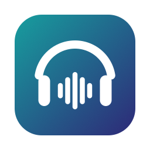

<p align="center">
  
</p>

<h1 align="center">Hifiguard</h1>

<p align="center">
  Keep your Bluetooth headphones sounding good when an app turns on the mic, plus a lightweight EQ for all system audio.<br>
  A small native menu bar app for macOS 15+ on Apple silicon.
</p>

> [!NOTE]
> **This app is vibecoded.** It was built mostly by an AI coding assistant, with a human directing the work and testing it on real hardware.
> Read the code before you trust it with anything important. Issues and PRs are welcome.

## The problem

When any app opens your Bluetooth headphones' microphone (a video call, a voice memo, a browser tab asking for the mic), macOS switches the headphones into a two-way "headset" mode.
Music then sounds thin, quiet and muffled until the mic is released.

## What Hifiguard does

### Hi-fi Lock (on by default)
- If your Bluetooth headphones become the **default input**, Hifiguard switches the default input to your Mac's built-in mic, or to another mic you choose.
- Your headphones stay in high-quality playback mode, and apps still get a working mic.
- When you turn the lock off or quit, Hifiguard puts back the input you had before.
- It reacts to headphones connecting and disconnecting, new mics being plugged in, and sleep/wake.
- **Honest limitation:** some apps (for example a meeting app where you picked the headphone mic yourself) use the headphone mic *directly*, whatever the default is.
  Hifiguard can't change that. Instead, the status line tells you which app is doing it, so you can pick a different mic in that app.

### Equalizer (off by default)
- A 10-band EQ for all system audio (32 Hz to 16 kHz, ±12 dB), with 12 presets.
- It uses Apple's Core Audio process taps (macOS 14.2+), so there's no kernel extension and no virtual audio driver to install.
- A look-ahead limiter is on by default to prevent clipping.
- If Hifiguard quits or crashes, normal sound comes back by itself.

### Updates
- Hifiguard checks GitHub for a new release when it starts and every day at 9:00. If your Mac is asleep at 9:00, it checks when the Mac wakes.
- When there's a new version, the panel shows a **Download** button. Nothing installs by itself.
- Turn on **Open at login** so Hifiguard starts (and checks) every time you log in.

### Lightweight on purpose
- Native Swift and SwiftUI. No Electron, no web views, no third-party packages.
- It reacts to system events instead of polling, so CPU use is about 0% while idle.
- The EQ's audio code doesn't allocate memory or take locks while processing sound.

## Install

1. Download the latest `Hifiguard-x.y.dmg` from [Releases](../../releases).
2. Open the DMG and double-click **Hifiguard** (or drag it into **Applications** yourself).
3. **The first time**, macOS will block it, because the app isn't signed with a paid Apple Developer ID or notarized by Apple:
   - Open **System Settings › Privacy & Security**, scroll down to the message about Hifiguard, and click **Open Anyway**.
   - Hifiguard then offers to **move itself to Applications**. Click **Move to Applications**: it copies itself there (replacing an older version), ejects the DMG, and restarts.
4. A headphones icon appears in the menu bar. Hifiguard has no Dock icon and no window.

To check that your download wasn't altered, compare its SHA-256 with the `.sha256` file attached to the release:
```bash
shasum -a 256 ~/Downloads/Hifiguard-*.dmg
```

### Permissions
- **Screen & System Audio Recording.** Hifiguard asks for this only when you **first turn on the Equalizer**, because macOS requires it before an app can process system audio.
  The audio is processed on your Mac and goes straight back out to your speakers or headphones. It is never recorded or sent anywhere.
- The Hi-fi Lock needs **no** permissions. Hifiguard never opens or records your microphone; it only changes which mic is the system default.

> Because the app isn't notarized, macOS may ask for the audio permission again after you update Hifiguard.

## Using it

Click the menu bar icon:

| Control | What it does |
|---|---|
| Status line | **Hi-fi**, **Call mode** (and which app caused it), or **No Bluetooth headphones** |
| Hi-fi Lock switch | Turns the lock on or off. Turning it off restores your previous input. |
| Mic | Which mic to use instead of the headphone mic. **Automatic** = your Mac's built-in mic. |
| Equalizer switch | Turns the EQ on or off (asks for permission the first time) |
| Preset / sliders | 12 presets, or set each band yourself (this shows as "Custom") |
| Limiter | Prevents clipping when you boost bands. Leave it on unless you know why you want it off. |
| Open at login | Starts Hifiguard when you log in (off by default) |
| Check for updates daily | On by default. Turn it off and Hifiguard makes no network requests at all. |

**Protect your hearing.** Big EQ boosts on headphones can get very loud. Start with your volume low.

## Troubleshooting

- **Still in call mode?** Look at the status line. If it names an app, open that app's audio settings and choose your Mac's microphone.
- **Equalizer says "Needs System Audio Recording permission":** allow Hifiguard in System Settings › Privacy & Security › Screen & System Audio Recording, then turn the Equalizer off and on.
- **Status says "macOS keeps picking headphone mic":** something keeps switching the input back. Turn the Hi-fi Lock off and on to try again.
- **No sound after a crash?** That shouldn't happen, because the EQ tap belongs to the app process and disappears with it. If it does, choose your output device again in System Settings › Sound.

## Build from source

You need Xcode 16 or later and macOS 15 or later on Apple silicon.

```bash
xcodebuild -scheme Hifiguard -configuration Release build
```
```bash
xcodebuild -scheme Hifiguard test
```
```bash
./Scripts/build-dmg.sh
```

The device-switching logic and the EQ controller sit behind protocols (`AudioSystem`, `AudioTapping`), so the unit tests run without any audio hardware.

| Path | What's there |
|---|---|
| `Hifiguard/Core/HiFiLock.swift` | Hi-fi Lock logic |
| `Hifiguard/Audio/` | Core Audio device and process monitoring |
| `Hifiguard/EQ/` | EQ (biquads, limiter, process tap) |
| `Hifiguard/UI/` | Menu bar panel |

## Privacy

Hifiguard collects no data: no analytics, no accounts, no licence checks.
Its only network request is the update check: it asks GitHub's public API (`api.github.com/repos/j0di3x/Hifiguard/releases/latest`) for the latest version number. Nothing about you or your Mac is sent beyond what any web request includes (such as your IP address, which GitHub sees). You can turn the update check off in the panel.
Settings are stored locally in macOS user defaults.

## Disclaimer

Hifiguard is an independent open-source project. It is **not affiliated with, endorsed by, or sponsored by Apple Inc.**
Apple, Mac, macOS, AirPods and Core Audio are trademarks of Apple Inc., registered in the U.S. and other countries. They are mentioned here only to describe compatibility.
All other product names belong to their respective owners.

The software is provided "as is", without warranty of any kind. See [LICENSE](LICENSE).

## License

[MIT](LICENSE)
